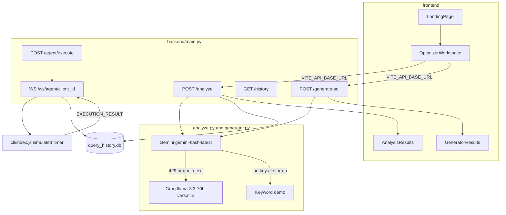

# QueryForgeAI — Engineering Audit

Audit date: 9 October 2026  
Scope: static inspection of `/Users/srii/Downloads/AI-SQL-Optimizer-main`  
Constraint: audit only. No application code, tests, configuration, dependencies, or schemas were changed during the inspection. This file is the saved report.

The optimizer cannot return a successful analysis. After the model or demo engine builds a result, history storage reads plan fields that do not exist, so `POST /analyze` becomes HTTP 500 and the workspace then treats that error body as a report.

## 1. Executive summary

QueryForgeAI is a React workspace and a FastAPI service. It asks Google Gemini, and sometimes Groq, to write SQL or to describe a query. With no Gemini key it uses keyword heuristics. The running service does not connect to PostgreSQL, MySQL, SQLite, or MongoDB, and it does not parse SQL.

The highest-value facts:

- `POST /analyze` stores history by reading `execution_cost` and `execution_time_ms`. `PlanNode` does not define those fields, so the handler raises and returns 500.
- Costs, row counts, and scan types are invented by the model or by string matching, then labeled “Execution Plan.”
- There is no authentication. Every stored query sits in one SQLite file, readable at `GET /history`.
- The PRO agent does not run SQL. It sleeps and reports a timer. The React app never calls the execute endpoint.
- Generated SQL is not checked for syntax, schema fit, dialect, or whether a rewrite still means the same thing.

## 2. Repository identity and Git state

| Item | Evidence |
| --- | --- |
| Local root | `/Users/srii/Downloads/AI-SQL-Optimizer-main` |
| Git metadata | No `.git` directory. This is an archive, not a working clone. `git` and `python3` are Xcode command-line stubs, so local Git and pytest could not run. |
| Public repo | [sriiverse/AI-SQL-Optimizer](https://github.com/sriiverse/AI-SQL-Optimizer), default branch `main`, HEAD `09e1029593076e1034a6c4090a2de0e0cdc2264b`, commit date 2026-04-07, message about cost optimization and execution-plan visualization. `pushed_at` on GitHub is 2026-04-20; the commit list has no newer commit. |
| Tree match | All 63 non-`node_modules` blobs on `main` match this directory, including committed `__pycache__`, `frontend/.env`, and `public_url.txt`. |
| Working tree | Source matches that commit. Cleanliness in the Git sense is unverified because there is no local `.git`. |
| Runtimes declared | CI: Python 3.9 and Node 18. Render: Python 3.10.13. Committed bytecode is `cpython-313`. README says Python 3.9+ in one section and 3.10+ in another. Node is not on `PATH` here. |
| Secrets | `backend/.env` is absent. `backend/.env.example` defines `GEMINI_API_KEY` and leaves it empty. `frontend/.env` is the same blob as `frontend/.env.example` (`VITE_API_BASE_URL` only). `GROQ_API_KEY` is read in code and is absent from the example file. |

Build and test commands that exist in the repo:

- Backend: `pip install -r backend/requirements.txt`, then `python -m pytest backend/tests/` or `uvicorn main:app`.
- Frontend: `npm ci`, `npm run build`, `npm run test` (Vitest). CI runs the build and does not run Vitest.
- CLI: `cli/package.json` script `test` exits 1.

Those commands were not executed. Python, Node, and Git are not usable in this environment.

## 3. Actual architecture

Components that are present:

- **Frontend** — Vite, React 19, TypeScript, Tailwind, Framer Motion. Routes `/`, `/optimizer`, `/generator`.
- **Backend** — FastAPI in `backend/main.py`. Modules: `analyze.py`, `generator.py`, `models.py`, `history_storage.py`, `socket_manager.py`, `cost_calculator.py`.
- **CLI agent** — `cli/index.js`, a WebSocket client. It does not open a database driver.
- **Ops scripts** — `start_app.ps1`, `go_live.ps1`, `tunnel.js` (localtunnel to port 5173), `render.yaml`, `frontend/netlify.toml`, `.github/workflows/ci.yml`.

Not found: Docker, a SQL parser dependency, an authenticated user model, a job queue, or a live database driver on the request path. `asyncpg` is imported only by `backend/benchmarks/compare_queries.py` and is not in `requirements.txt`.

`HistorySidebar.tsx` and `SqlEditor.tsx` are never imported. `@monaco-editor/react` is therefore unused by the screens that render.

## 4. End-to-end flows

**1. Question, schema, SQL.** `OptimizerWorkspace.handleGenerate` posts `{schema_def, question, dialect}` to `/generate-sql` (`frontend/src/pages/OptimizerWorkspace.tsx` 119–136). `generate_sql_endpoint` (`backend/main.py` 100–114) calls `generate_sql_with_gemini` when the startup model exists, otherwise `generate_sql_demo` or `generate_mongodb_demo`. The prompt is one user string (`backend/generator.py` 216–251 for SQL, 11–214 for MongoDB). The reply is split on `SQL:` / `QUERY:` / `Explanation:`. Mongo text then passes `validate_mongodb_query`, which appends warnings and still returns the text.

**2. SQL in, analysis out.** `handleAnalyze` posts `{query, dialect}` (`OptimizerWorkspace.tsx` 100–117). `schema_context` exists on `AnalyzeRequest` (`backend/models.py` 6) and is never forwarded (`backend/main.py` 81–83). `analyze_query_with_gemini` asks the model for a one-node `execution_plan_summary` (`backend/analyze.py` 41–66). Demo mode pattern-matches `select *`, `where`, and `like '%'` (`analyze.py` 164–217). The result is passed to `history_storage.add_entry` before the response is returned (`main.py` 93).

**3. Agent.** The PRO modal is static copy (`ProConnectionModal.tsx` 104–125). No frontend call to `/agent/execute` or `/history` was found. The CLI connects to `ws://localhost:8000/ws/agent/{clientId}`, prints the query, waits a short timeout, and sends `EXECUTION_RESULT` with wall-clock time of that wait (`cli/index.js` 21–88). The connection string is only displayed. The socket handler builds a mock `AnalysisResult` whose original query is the literal `[Query executed via CLI agent]` (`main.py` 158–178).

**4. History.** `HistoryStorage` creates `query_history.db` in the process working directory at import (`history_storage.py` 13–16, 168). `GET /history` returns the latest rows with no owner filter (`main.py` 223–229). `delete_history` has no route.

**5. Provider failure.** Startup initializes Gemini only when `GEMINI_API_KEY` is set (`main.py` 27–36). A missing key selects demo mode and does not try Groq. A Gemini exception whose text contains `429` or `quota` tries Groq once if `GROQ_API_KEY` is set (`analyze.py` 74–106, `generator.py` 257–283). Other failures return an `ERROR` payload with HTTP 200 from the analyzer functions. Generate has an extra path: if the model text has no query prefix and does not look like SQL, it returns demo SQL with HTTP 200 (`generator.py` 323–333).

**6. Frontend failure.** `fetch` has no timeout and no `AbortController`. Non-OK responses are still stored as the result (`OptimizerWorkspace.tsx` 109–110). A FastAPI error body is `{detail: ...}`. `AnalysisResults` then evaluates `result.suggestions.length` (`AnalysisResults.tsx` 77). Network failures are `console.error` only (`OptimizerWorkspace.tsx` 112–114), so the panel returns to the empty state. Keep-alive uses `VITE_API_URL` (`App.tsx` 6). Analyze and generate use `VITE_API_BASE_URL`.

## 5. API inventory

| Method | Path | Request | Response | Notes |
| --- | --- | --- | --- | --- |
| GET | `/` | none | `{status, message}` | |
| GET | `/health` | none | `{status: ok}` | |
| GET | `/ping` | none | `{status, timestamp}` | |
| POST | `/analyze` | `AnalyzeRequest`: `query`, optional `schema_context`, `dialect` default `postgresql` | `AnalysisResult` | `schema_context` unused. History write can 500. |
| POST | `/generate-sql` | `TextToSqlRequest`: `schema_def`, `question`, `dialect` | `TextToSqlResponse`: `query`, `explanation` | No history write. |
| WS | `/ws/agent/{client_id}` | text frames | `EXECUTE` JSON | No auth. New connection replaces the old one (`socket_manager.py` 12–14). |
| POST | `/agent/execute` | `{client_id, query}` | 200 or 404 | Forwards the query string to the socket. |
| POST | `/agent/execution-result` | query `client_id`, body `{status, execution_time_ms, note}` | `{status: success}` | Acknowledges and does not store (`main.py` 210–220). |
| GET | `/history` | `limit` default 50, no maximum | `{history: [...]}` | Shared database. |

CORS is `allow_origins=["*"]`, `allow_credentials=True`, all methods and headers (`main.py` 49–56). No auth middleware, rate limiter, or body-size limit was found.

`PlanNode` is `node_type`, `cost`, `rows`, optional `relation_name`, `children` (`models.py` 9–14). `Suggestion.impact` is an unconstrained string.

## 6. SQL correctness

| Concern | Status |
| --- | --- |
| Dialect differences | Prompt says “use this dialect.” No dialect allow-list. Demo SQL is PostgreSQL-shaped (`INTERVAL`, `GENERATE_SERIES` is only in the prompt). |
| Schema and relationships | Generator receives `schema_def` as text. Optimizer ignores `schema_context`. No catalog lookup. |
| Identifiers, keywords, types, nullability | Not implemented. Demo inserts the first `\w+` name from the schema (`generator.py` 547–561). |
| Joins, grouping, windows, CTEs, dates, NULL | Instructed in the prompt (`generator.py` 224–247). Not checked. |
| Parameterized queries | Not found. Output is literal text. |
| Injection boundary | The API does not execute SQL. `compare_queries.py` interpolates the statement into `EXPLAIN (FORMAT JSON) {query}` (line 13). The CLI does not execute it. |
| Multiple statements and DML/DDL | Accepted. The generate prompt’s salvage list includes `insert`, `update`, and `delete` (`generator.py` 324). |
| Transactions, locks, permissions, timeouts | Not found on the request path. |
| Rewrites that change meaning | `analyze_query_demo` replaces `*` with `id, name, email` (`analyze.py` 215). No equivalence check. |
| Parser / AST / engine | Not found. Mongo generate uses brace counting and regex (`generator.py` 359–544). SQL generation has no equivalent. |
| Large schemas and ambiguous questions | No length cap. Ambiguity is left to the model. |
| Validation layer | Syntactic validity, schema compatibility, semantic equivalence, and measured performance are all missing. Estimated numbers come from the model or from constants such as `cost=1250.0` and `rows=10000`. |

## 7. AI and provider behavior

| | Gemini | Groq | Demo |
| --- | --- | --- | --- |
| Model | `gemini-flash-latest`, once at startup (`main.py` 31) | `llama-3.3-70b-versatile`, new client per fallback | Keyword branches in `analyze.py` and `generator.py` |
| Prompt | Single user string. No `system_instruction`, no `response_schema`, no `response_mime_type` | Same string as `role: user`. Temperature 0.2. `max_tokens` 2000 analyze / 3000 generate | None |
| Temperature | Not set in code. Library default is unverified. | 0.2 | n/a |
| Timeout / retry | Not found. One Groq attempt. | No second retry. | Immediate |
| When used | Key present at startup | Gemini error text contains `429` or `quota`, and `GROQ_API_KEY` is set | No Gemini model, or generate parse salvage (`generator.py` 329–333) |
| Output contract | JSON for analyze, `SQL:` / `Explanation:` for generate. Markdown fences are stripped. Truncation and `finish_reason` are not checked. | Same prompt, so the context matches. Token cap can cut a long Mongo answer. | Fixed templates. SQL analyze explanation does not say demo (`analyze.py` 216). Generate explanations start with `[Demo Mode — AI unavailable]`. |

Schema comments and the question sit in the same user message as the rules. A pasted instruction can compete with those rules. The server still only returns text.

The UI header always says `Gemini AI` (`OptimizerWorkspace.tsx` 377), including demo and error payloads.

## 8. Execution plans and truthfulness

| Phrase in the product | What the code does | Category |
| --- | --- | --- |
| “Analyze Execution Plan” | Asks a model for `node_type`, `cost`, `rows`, or fabricates them | Model output or heuristic |
| “Running cost estimation on execution paths” | Rotating loading copy (`OptimizerWorkspace.tsx` 14–20) | Marketing copy |
| Execution plan tree | `ExplainTree` reads `Node Type`, `Startup Cost`, `Plan Rows` (`ExplainTree.tsx` 87–98). The API sends `node_type`, `cost`, `rows`. `execution_plan.dialect` is never set, so the PostgreSQL converter always runs (`AnalysisResults.tsx` 29). Detail text stays empty. Children are never filled by the analyzers. | UI mismatch |
| “Recommended Query” | Model string, or the `*` replacement | Suggestion |
| Dollar cost | `calculate_execution_cost` multiplies a timer by a hardcoded hourly rate (`cost_calculator.py` 6–35). The analyzer never sets `execution_time_ms`, so this runs only on the socket path, which then fails when history reads the dropped fields. | Formula, not a bill |
| “Run True EXPLAIN Plans” | CLI comment says a real driver would run here (`cli/index.js` 43–48). The sent note says “Executed on local database with real timing measurement” (line 86). | Synthetic |
| `compare_queries.py` | `EXPLAIN` total cost, not `EXPLAIN ANALYZE` | Estimated, and not called by the API |
| Index and join advice | Model or demo suggestion text | Heuristic |

A truthful contract, not implemented here, would return `analysis_source` (`gemini`, `groq`, `demo`, `error`), `dialect`, `database_connected: false`, `plan_origin: synthetic`, and `performance: not_measured`. The UI would show those fields. Confidence belongs on suggestions only where a deterministic check actually ran, such as the Mongo regex warnings.

## 9. Security and privacy

**QF-03, confirmed, P1.** No authentication on any route. History has no user key. A client that can reach the server can read every stored query and schema fragment and can spend the server’s Gemini or Groq quota. Preconditions: the process is reachable and a provider key is configured. `query_history.db` is not listed in `.gitignore`.

**QF-06, confirmed, P1.** `/ws/agent/{client_id}` accepts any id. `/agent/execute` delivers that query to whoever connected last with that id. Today the CLI does not run it, so this is query disclosure and a forged timing, not confirmed code execution. The modal tells users to pass a database URL on the command line (`ProConnectionModal.tsx` 121). `@queryforge/cli` and `queryforge login` are not in this repository.

**QF-10, confirmed, P2.** Unbounded `query`, `schema_def`, and `question` strings, no rate limit, no provider timeout. A public Render deploy with a real key can be driven as a billing proxy.

**QF-12, confirmed, P2, not an exposed endpoint.** The benchmark script composes SQL into `EXPLAIN` with an f-string. Impact requires someone to run that script against a database. This audit did not.

**QF-16, likely, P3.** `HTTPException(detail=str(e))` and analysis explanations include exception text (`main.py` 96–97, `analyze.py` 109–114). Whether those strings contain an API key was not observed. Websocket frames are printed in full (`main.py` 141).

**CORS.** The app allows every origin and credentials together (`main.py` 50–54). Browser reflection of `Origin` was not executed, so the exact header behavior is unverified. Unauthenticated routes are already callable without a browser.

**Not found:** SSRF from user input, path traversal, file upload, cookie sessions, or server-side execution of generated SQL. `tunnel.js` fetches `https://api.ipify.org` and writes a tunnel URL; that is an operator script, and `public_url.txt` is already committed.

Dependency CVEs were not scanned. Requirements use open `>=` ranges.

Privacy copy in the README and the amber banner is accurate about one thing: the query, schema, and question are what get sent to Google when Gemini is configured. The same text is also written to the shared SQLite file. The PRO modal’s “zero data retention” and “passwords never leave your laptop” describe a design the CLI does not implement, because the CLI never logs into a database and the server still stores the query text it is given.

## 10. Performance and reliability

Measured in this session: none. The runtime could not start. These are code-level limits:

- Gemini and Groq calls are awaited, so they do not block the event loop by themselves. SQLite connect/insert/close inside the async handlers does block it (`history_storage.py` 85–109). Concurrent writes use a new connection each time and can hit SQLite’s lock. That lock behavior was not measured.
- Provider latency is uncapped. There is no client timeout, so one hung call occupies the request until the process or proxy gives up.
- Fallback is a single extra call, not a retry loop.
- Plans are one node. Memory growth on the happy path is the prompt size. History rows accumulate with no retention job.
- The socket map drops a client on `WebSocketDisconnect` (`main.py` 188–189). A dead socket stays until the next send fails (`socket_manager.py` 36–38). No heartbeat or max message size is set in this code.
- `python main.py` starts Uvicorn with `reload=True` (`main.py` 236). The Render start command does not.
- Frontend highlight work is memoized in `GeneratorResults`. The loading panel is cosmetic. `SqlEditor` is unused, so Monaco is not on the live path.

Proposed benchmarks, with no numbers invented:

| Workload | Fixture | Metric | Baseline | Acceptance | Safety |
| --- | --- | --- | --- | --- | --- |
| Demo analyze | `SELECT * FROM users` | HTTP status and p95 handler time | Current code returns 500 | 200, history failure does not change status, p95 under 50 ms on a laptop | No provider, no database |
| Large schema | 200 KB DDL fixture | Bytes sent to the provider and response status | Unbounded today | Reject above a stated cap before the provider call | Mock the provider |
| History concurrency | 20 parallel demo analyzes | SQLite errors and row count | Unknown | No 500 from lock errors; row count equals successes | Temp database file |
| Plan honesty | Demo and a recorded Gemini JSON fixture | `plan_origin` and UI label | UI says Gemini AI | Label matches the fixture source | No live provider |

## 11. Test coverage

Existing tests (`backend/tests/test_main.py`): `GET /`, `GET /health`, and two mocked provider posts. They patch `get_model` and the Gemini functions. They never call demo mode, Groq, the parser, history, sockets, or validation. The analyze mock returns a dict; `add_entry` still runs and expects an `AnalysisResult`, so that test is predicted to get 500. That prediction was not executed.

`frontend/src/tests/App.test.tsx` expects the text `Optimize SQL Queries`. The landing heading is `Optimize Database` and `Queries` (`LandingPage.tsx` 139–144). CI does not run Vitest.

Missing, in the order they would catch the current failures:

- Unit: demo analyze and the history writer against the real `PlanNode`.
- Contract: `/analyze` and `/generate-sql` status codes, error bodies, and source labels.
- Provider-mocked: 429 to Groq, non-429 to a visible error, empty model text to an explicit demo flag, truncated JSON.
- Mongo and SQL fixtures: known-bad pipelines for the regex warnings; a rewrite that changes a filter must not be marked equivalent.
- Socket: disconnect removes the client; a second connection does not silently replace the first without a defined rule; execute requires auth once auth exists.
- Frontend: HTTP 500 and network failure render an error, and the result panel does not read `suggestions` on an error body.
- Optional live provider and optional `EXPLAIN` against a disposable database, gated and read-only.

Do not weaken `App.test.tsx` to match the headline. Change the assertion only when the product copy is chosen on purpose.

## 12. Product and UX trust

A user cannot tell these apart from the screen:

- Generated text and checked SQL. The copy button copies either.
- A suggestion and a measured speedup. Impact badges are the model’s `High` / `Medium` / `Low`, and unknown values fall through to the Low style (`AnalysisResults.tsx` 83).
- A synthetic plan and an engine plan. The section title is “Execution Plan.”
- Demo and Gemini. The clock line says Gemini AI.
- Provider failure and success. Analyze errors are HTTP 200 with `optimized_query: "ERROR"`, or HTTP 500 when history throws. Generate demo is HTTP 200.
- Estimated cost and a measured time. History rows show dollars and milliseconds that the analyzer never produced. The sidebar that would show them is not mounted.

Loading steps say the app is parsing structure, mapping joins, and validating dialect syntax. Those steps are a timer (`OptimizerWorkspace.tsx` 433–444).

## 13. Findings

| ID | Sev | Confidence | Behavior | Why it matters | Fix | Tests | Size |
| --- | --- | --- | --- | --- | --- | --- | --- |
| QF-01 | P0 | Confirmed | `add_entry` reads missing plan attributes (`history_storage.py` 57–64, `models.py` 9–14, `main.py` 93) | Core optimizer returns 500, then the UI crashes on `suggestions` | Store `cost` or make history failure non-fatal | Demo `POST /analyze` returns 200 | S |
| QF-02 | P1 | Confirmed | Model and demo invent plan numbers (`analyze.py` 48–53, 171–176, 216) | Users can treat fiction as an engine plan | `plan_origin: synthetic` on every current response | Fixture asserts the label | S |
| QF-03 | P1 | Confirmed | Open `GET /history` and global SQLite (`main.py` 223–229) | Pasted SQL and schemas are shared | Auth or disable history on public deploys; ignore `*.db` | Two clients cannot read each other’s rows | M |
| QF-04 | P1 | Confirmed | No parser; `schema_context` unused; demo rewrites `*` (`analyze.py` 215) | A rewrite can change results and still look recommended | Read-only gate plus parser; stop calling it optimized until checked | Known semantic-change fixture | L |
| QF-05 | P1 | Confirmed | User-only prompt; Groq only on quota text; silent demo (`generator.py` 323–333) | Failures look successful; schema text can steer the model | System instruction, JSON schema, explicit fallback reason | Recorded 429, 500, and garbage payloads | M |
| QF-06 | P1 | Confirmed | Unauthenticated socket; CLI simulates (`cli/index.js` 43–88) | Query text goes to any matching `client_id`; copy says the database ran | Auth before execute; stop the “local database” note until a driver exists | Reject unknown clients; simulated path labeled simulated | M |
| QF-07 | P2 | Confirmed | No `res.ok`, no timeout; two API env names (`App.tsx` 6, `OptimizerWorkspace.tsx` 104) | Failures look like an empty editor or a blank crash | One base URL, timeout, error panel | 500 and offline cases | S |
| QF-08 | P2 | Confirmed | Tree reads different JSON keys (`ExplainTree.tsx` 83–103) | The plan card hides the only numbers the API sent | Render `node_type`, `cost`, `rows`, `children` | Serializer fixture | S |
| QF-09 | P2 | Confirmed | Optimized SQL is not the column that gets inserted (`history_storage.py` 79–84); sidebar unused | History cannot show the rewrite the model returned | Persist `result.optimized_query` | Round-trip one row | S |
| QF-10 | P2 | Confirmed | No rate limit, cap, or provider timeout | Public key can be exhausted | Body limit and a per-IP budget before the provider | Oversized body is 413 | M |
| QF-11 | P2 | Confirmed | Tests miss the broken path; landing assertion disagrees with the heading | CI can stay green while analyze is dead | Cover QF-01 and the real heading | Existing pytest plus the landing test | S |
| QF-12 | P2 | Confirmed | Benchmark interpolates SQL; `asyncpg` not required | Unsafe if someone points it at a database | Parameters or a read-only explain wrapper; add the dependency only if the script stays | Static test that the helper rejects multiple statements | S |
| QF-13 | P3 | Confirmed | `SqlEditor` and `/agent/execution-result` are unused | Extra surface and a success response that stores nothing | Delete or wire them after the contract exists | Import graph or route list | S |
| QF-14 | P3 | Confirmed | README “100% uptime,” loading steps, PRO EXPLAIN copy | Trust erodes when the first real query fails | Copy matches `plan_origin` | Snapshot of the badge | S |
| QF-15 | P3 | Confirmed | Committed `backend/__pycache__`, root `node_modules`, `public_url.txt` | Noise and a stale tunnel address in Git history | Stop tracking them | CI path check | S |
| QF-16 | P3 | Likely | `str(e)` returned to the client | Provider errors can leak request details | Stable error code, log the exception server-side | 500 body has no exception text | S |

Verification for QF-01 without a server: construct `PlanNode(node_type="Seq Scan", cost=1, rows=1)` and read `execution_cost`. That attribute is absent. The handler does not catch `AttributeError` separately; the broad `except` turns it into HTTP 500.

## 14. Roadmap

**P0.** QF-01 only. History must not be able to discard a finished analysis.

**P1.** QF-02 through QF-06. Label synthetic plans, refuse or flag unchecked rewrites, split instructions from schema text, authenticate the agent channel, and stop publishing one global history.

**P2.** QF-07 through QF-12. Error UI, plan tree, history row shape, quotas, tests, and the benchmark script.

**P3.** QF-13 through QF-16. Dead code, copy, repo hygiene, error redaction.

Each P1 item blocks calling the product an optimizer. QF-02 can ship with QF-01. QF-04 blocks any later “measured speedup” work. Real `EXPLAIN` should wait until the agent is authenticated and the result type can say `plan_origin: engine`.

## 15. First implementation slice

Repair the analyze response and name its source. Leave live databases out.

1. In `add_entry`, use fields that exist, and isolate storage errors so `POST /analyze` still returns the analysis.
2. Add `analysis_source` and `plan_origin: synthetic` to analyze and generate responses, including demo and error.
3. In the workspace, require `res.ok`, show `detail` or a network error, and replace the fixed “Gemini AI” line with those fields.

Benefit: the optimizer answers again, and a demo plan is identifiable. Risk: clients that assume the old JSON shape need the new fields to be additive. Tests: demo analyze returns 200; a forced history exception still returns 200; the rendered header matches `analysis_source`. Size S. It blocks every later trust and history task.

## 16. Baseline tests and build

Not run. `/usr/bin/python3` and `/usr/bin/git` are Xcode stubs. `node` is not on `PATH`. Frontend `node_modules` is not installed. Predicted from code, and still unverified: `test_analyze_endpoint_mock` fails in `add_entry`, and the landing Vitest fails on the heading text. `test_generate_endpoint_mock` does not touch history.

## 17. Uncertainties

- pytest, Vitest, `npm run build`, and a live Gemini or Groq call were not run.
- Starlette’s exact CORS header when credentials and `*` are combined was not observed.
- Gemini’s default temperature and whether exception strings can contain the API key were not observed.
- SQLite lock behavior under parallel requests was not measured.
- No CVE scan.
- Local Git status is unavailable. The blob comparison to GitHub `main` at `09e1029593` is the identity check.

## Closing

The five highest-value findings are the analyze 500 (QF-01), synthetic plans shown as engine plans (QF-02), shared unauthenticated history (QF-03), unchecked SQL rewrites (QF-04), and the unauthenticated agent that reports a database timing it did not measure (QF-06). The first slice is QF-01 plus an explicit `analysis_source` and `plan_origin` on the response and in the workspace.

QueryForgeAI audit complete. No implementation changes made.
