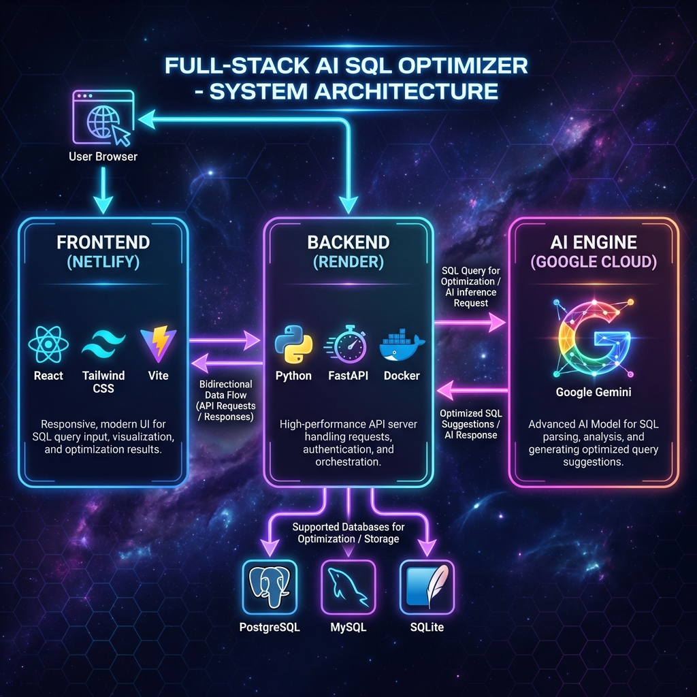

# QueryForgeAI — SQL review and query drafts



[]()
[]()
[]()

A query-review assistant for **PostgreSQL**, **MySQL**, **SQLite**, and **MongoDB**. With a server-side access token it can ask **Google Gemini**, and **Groq** after a Gemini quota error. Otherwise it uses a keyword demo. It does not connect to a database, inspect an engine execution plan, or measure execution time.

---

## What it does

### 🛡️ Multi-Provider API Resilience
*   **Primary model:** Google Gemini (`gemini-flash-latest`) when paid provider access is enabled.
*   **Quota fallback:** One Groq `llama-3.3-70b-versatile` attempt after a Gemini response that reports a quota error. A timeout does not start Groq. This does not guarantee uptime.
*   **Demo:** Keyword checks when paid access is closed or no model is configured.

### 🧠 Elite Analytics Guardrails
The generation prompt asks the model to follow a written checklist. The app does not prove that the model obeyed it.
*   **SQL prompt notes:** CTE scoping, `GENERATE_SERIES()` for sparse time series, and rolling averages.
*   **MongoDB prompt notes:** `$graphLookup` depth, `$setWindowFields`, and faceted aggregations.

### 🔍 Intelligent Optimization
*   **Keyword demo:** Can note `SELECT *`, a missing `WHERE`, and a leading-wildcard `LIKE`. It does not inspect an engine execution plan.
*   **Dialect label:** The selected dialect is sent with the prompt. Advice is not verified against that engine.

### ✍️ Schema-Aware Generator
*   **Natural language draft:** Turns a question and schema text into a suggested query. Length and correctness are not guaranteed.
*   **Schema text:** The schema you paste is included in the prompt. The app does not check that the query matches that schema.

---

## 🚀 Quick Start

### Prerequisites
*   Node.js 20.19+ or 22.12+ (Vite 7 and Vitest 4)
*   Python (v3.9+)
*   Google Gemini API Key ([Get one here](https://aistudio.google.com/))

### 1. Clone & Install
```bash
git clone https://github.com/sriiverse/AI-SQL-Optimizer.git
cd AI-SQL-Optimizer
```

### 2. Backend Setup
```bash
cd backend
pip install -r requirements.txt
# Copy backend/.env.example to backend/.env.
# GEMINI_API_KEY alone does not call a provider. See PROVIDER_ACCESS_TOKEN.
python main.py
```
*Server runs at `http://localhost:8000`*

### 3. Frontend Setup
```bash
cd frontend
npm install
npm run dev
```
*App runs at `http://localhost:5173`*

---

## 💡 Example Workflows

### Scenario 1: Optimizing a Slow Query
**Input:**
```sql
SELECT * FROM orders WHERE DATE(created_at) = '2023-01-01'
```
**AI Analysis:**
> *"Using a function like `DATE()` on a column prevents index usage (SARGable violation). This causes a Full Table Scan."*

**Optimized Output (PostgreSQL):**
```sql
SELECT * FROM orders 
WHERE created_at >= '2023-01-01 00:00:00' 
  AND created_at < '2023-01-02 00:00:00';
```

### Scenario 2: Generating Reports
**Question:** *"Show me top 5 customers by speed of payment"*
**Schema Context:** `payments (amount, date, customer_id)`, `customers (id, name)`
**AI Output:**
```sql
SELECT c.name, AVG(p.date - o.order_date) as avg_payment_speed
FROM customers c
JOIN payments p ON c.id = p.customer_id
GROUP BY c.id
ORDER BY avg_payment_speed ASC
LIMIT 5;
```

---

## 🔒 Privacy & Data Safety

This application sends data to **Google's Generative AI API**.
*   **What is sent:** The SQL Query, Table Schema, and Natural Language Question you provide.
*   **What is NOT sent:** Database credentials, connection strings, or actual row data (unless you paste row data into the schema box).
*   **Recommendation:** Use randomized/anonymized table names (e.g., `table_a`) if your schema contains highly sensitive trade secrets.

### History and local agent

Both switches default to off. Only `1`, `true`, `yes`, or `on` enables one. Neither switch is authentication.

*   `HISTORY_ENABLED`: when off, `POST /analyze` does not write history and `GET /history` returns `History is disabled`. Do not enable this on a shared or public server. The store is one SQLite file with no per-user isolation, and turning the flag on does not make that store safe.
*   `AGENT_ENABLED`: when off, the agent WebSocket and `/agent` routes stay closed. Turning it on only enables the existing agent channel. It does not authenticate clients and does not make that channel safe for a public multi-user deployment. Leave it off until access control exists. The CLI in `cli/index.js` is a simulated timer. It does not connect to a database, run `EXPLAIN`, measure database time, or implement a login command.
*   The history file is created only when `HISTORY_ENABLED` is on and a request reads or writes history. A disabled `GET /history` does not open the database.

### Paid provider access

`PROVIDER_ACCESS_TOKEN` is unset by default. While it is unset, `POST /analyze` and `POST /generate-sql` stay on the demo engines. They do not call Gemini or Groq, even when `GEMINI_API_KEY` or `GROQ_API_KEY` is set. The per-IP rate limit and CORS are not this control.

To turn paid calls on, set `PROVIDER_ACCESS_TOKEN` on the server to a long random secret. A caller must send `Authorization: Bearer <that secret>`. A missing or wrong token returns 403 and does not call a provider. Do not put the secret in the frontend, in Netlify, or in a `VITE_` variable. The hosted page cannot send it. If the token is set, that page receives 403 instead of a demo result. Leave the token unset when the public page should keep the free demo.

### Request limits

These values are read when the backend process starts. A malformed value stops startup instead of turning the protection off.

*   SQL query: 20,000 characters (`MAX_QUERY_CHARS`)
*   Schema text: 100,000 characters (`MAX_SCHEMA_CHARS`), including optional analyze `schema_context` and generation `schema_def`
*   Natural-language question: 4,000 characters (`MAX_QUESTION_CHARS`)
*   Request body: 262,144 bytes (`MAX_BODY_BYTES`)
*   Analysis provider deadline: 30 seconds (`ANALYSIS_TIMEOUT_SECONDS`)
*   Generation provider deadline: 45 seconds (`GENERATION_TIMEOUT_SECONDS`)
*   `POST /analyze` and `POST /generate-sql` share a limit of 20 requests per direct client IP per 60 seconds (`RATE_LIMIT_REQUESTS`, `RATE_LIMIT_WINDOW_SECONDS`). Health checks are not counted. The limiter keeps at most 10,000 IP entries (`RATE_LIMIT_MAX_KEYS`). It lives in process memory, so it is not a shared limit across workers or instances. This deployment has no trusted proxy, and `X-Forwarded-For` is not used.

Supported dialects are `postgresql`, `mysql`, `sqlite`, and `mongodb`.

---

## 🏗️ System Architecture
The application follows a **Hybrid Cloud Architecture**:
*   **Frontend:** React (Vite) + Tailwind CSS + Framer Motion. Hosted on **Netlify**.
*   **Backend:** FastAPI (Python) running on **Render**.
*   **AI Engine:** **Google Gemini Flash**.

---

## 🛠️ Deployment
## 🛠️ Tech Stack

*   **Frontend:** React, TypeScript, Vite, Tailwind CSS, Framer Motion (for smooth UI/UX).
*   **Backend:** Python, FastAPI, Uvicorn, Google Generative AI (`google-generativeai`), Groq (`groq`).
*   **Deployment:** Designed for Render (Backend) and Netlify (Frontend).

---

## 🚀 Getting Started

### Prerequisites
*   Node.js 20.19+ or 22.12+, and npm
*   Python 3.10+
*   Google Gemini API Key (Optional, for Real AI features)

### Local Setup

1.  **Clone the repository**
    ```bash
    git clone https://github.com/sriiverse/AI-SQL-Optimizer.git
    cd AI-SQL-Optimizer
    ```

2.  **Backend Setup**
    ```bash
    cd backend
    pip install -r requirements.txt
    
    # Optional: paid AI for a trusted client, not the public website.
    # Create backend/.env with GEMINI_API_KEY and PROVIDER_ACCESS_TOKEN.
    # Send Authorization: Bearer <PROVIDER_ACCESS_TOKEN>.
    # The key alone leaves /analyze and /generate-sql on the demo path.
    
    uvicorn main:app --reload
    ```

3.  **Frontend Setup**
    ```bash
    cd frontend
    npm install
    npm run dev
    ```

## ☁️ Deployment

### Backend (Render)
*   **Build Command:** `pip install -r requirements.txt`
*   **Start Command:** `uvicorn main:app --host 0.0.0.0 --port $PORT`
*   **Environment Variables:** `GEMINI_API_KEY` and `GROQ_API_KEY` stay on the server. They do not enable public paid calls. Set `PROVIDER_ACCESS_TOKEN` only for a trusted client that can send `Authorization: Bearer`. Leave that token unset on a public demo. Do not set `HISTORY_ENABLED` or `AGENT_ENABLED`.

### Frontend (Netlify/Vercel)
*   **Build Command:** `npm run build`
*   **Output Directory:** `dist`
*   **Environment variable:** `VITE_API_BASE_URL`
*   Set it in the Netlify site environment to the public Render origin, with no path and no trailing slash. This repository does not record that host. A production build with the variable missing does not call localhost. Local `npm run dev` uses `http://localhost:8000` when the variable is unset. Do not put provider keys or `PROVIDER_ACCESS_TOKEN` in the frontend environment.

---

## 📸 Screenshots
*(Add your screenshots here)*
